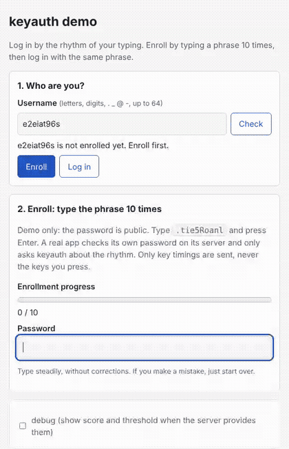

# Tempo

Log in by the rhythm of your typing. Tempo is a keystroke-dynamics biometric: it learns how *you* type your password
(how long you hold each key, how quickly you move to the next) and checks that rhythm at login, as a second factor
next to the password.



*The demo page, recorded with a scripted browser: it enrolls with 10 attempts, then logs in.*

> The Python package, environment variables and script are still named `keyauth` (`import keyauth`, `KEYAUTH_*`).

## How it works

1. **Capture.** The browser records key down/up times in milliseconds. It replaces every key with an anonymous
   placeholder (`x`, `k0`, `k1`, ...) before sending, so **the server never learns what was typed**.
2. **Features.** Each keystroke becomes three timings in seconds: `hold`, `dd` (down to next down) and `ud` (up to
   next down), the layout of the CMU Keystroke Dynamics Benchmark.
3. **Embedding.** A small PyTorch encoder (Conv1d, BiGRU, pooling) maps an attempt to a point on the unit sphere,
   trained with a supervised contrastive loss. New users need no retraining.
4. **Enrollment.** The user types the phrase 10 times; the template is the mean embedding.
5. **Verification.** Accept if the distance to the template is under a threshold chosen on validation users (per
   user by default, from how consistent their enrollment was). The engine also rejects replays, locks the account
   after repeated failures, and adapts the template slowly as rhythm drifts.

The engine never sees the password: the app checks it, and Tempo answers only "does the rhythm match?".

## Results

CMU Keystroke Dynamics Benchmark: 51 typists, one password, 10 enrollment attempts, test users unseen in training,
threshold picked on validation users only. Equal error rate (EER, lower is better), mean ± std over 5 user splits.

| method | val EER | test EER |
|---|---|---|
| Scaled Manhattan (classic baseline) | 23.72 ± 1.57 % | 22.14 ± 5.98 % |
| Mahalanobis (classic baseline) | 22.45 ± 2.62 % | 23.27 ± 4.89 % |
| **Tempo encoder** | 18.76 ± 4.47 % | **21.50 ± 9.30 %** |

Honest reading:
- **It's a tie, not a win.** It matches classic detectors from 2009, and with 8 test users per split any single number
  is about ± 5 points.
- **Pretraining on 7,748 typists of free text (Aalto) did not help.** After CMU fine-tuning it tied on test
  (21.48 % vs 21.23 %), so it is not shipped.
- **10 enrollment attempts is few.** The classic study used 200.

On its own this cannot authenticate anyone. Use it as a soft signal next to a password. Per-seed tables, the
val/test gap and failure cases: [docs/RESULTS.md](docs/RESULTS.md).

## Run it

Needs Python 3.10+.

```bash
pip install -e ".[dev,app]"
```

```bash
python scripts/get_cmu.py
```

```bash
python -m keyauth.train --data cmu
```

```bash
python -m keyauth.api
```

This downloads the CMU data into `data/`, trains in about 2 minutes on a laptop CPU (writes `checkpoints/model.pt`),
and serves the API and demo page at http://127.0.0.1:8000/. Set `KEYAUTH_DEBUG_SCORES=1` to see scores in the page.
All settings are environment variables, listed in [.env.example](.env.example).

No CMU download? Train on synthetic typists to try the pipeline (its numbers are not CMU numbers):
`python -m keyauth.train --data synthetic --epochs 5`.

**Docker.** The model is not baked into the image: train first, then mount `checkpoints/`.

```bash
docker build -t tempo .
```

```bash
docker run --rm -p 8000:8000 -v "$PWD/checkpoints:/app/checkpoints:ro" -v tempo-state:/app/state tempo
```

## API

| Endpoint | Purpose |
|---|---|
| `POST /enroll` `{user_id, events \| timings}` | add one enrollment attempt |
| `POST /verify` `{user_id, events \| timings}` | `{accepted, reason}`; locked accounts get 423 |
| `GET /status?user_id=` | enrollment and lock status |
| `DELETE /user?user_id=` | delete a template; needs `Authorization: Bearer $KEYAUTH_ADMIN_TOKEN` |
| `GET /health` | liveness and whether the model loaded |

Errors have the shape `{"error": {"code", "message"}}`. Requests are rate-limited. Logs carry a hash of `user_id`
and the outcome, never timings or scores.

## Use it on other sites (demo)

With `KEYAUTH_ENABLE_V1=1`, Tempo also runs a Turnstile-style service under `/v1`. A customer page adds
`keyauth.js` and gets back only a signed, single-use 60 s token; the customer's **server** then calls
`/v1/siteverify` and decides. [`demo_site/`](demo_site/README.md) is a small customer site that does this end to
end, with a browser test (`scripts/run_integration_e2e.sh`). Details and threat model: [docs/SERVICE.md](docs/SERVICE.md).
It is a demo, not a hardened production service.

Self-host it: `sh scripts/selfhost_init.sh`, then `docker compose up -d --build` (train a model first with
`docker compose --profile train run --rm train`). Copy-paste server helpers for Python and Node are in `integrations/`.
Setup, backups, TLS and your duties for biometric data: [docs/SELF_HOSTING.md](docs/SELF_HOSTING.md). It is a soft signal (~21% EER), not for blocking logins.

## Tests

```bash
python -m pytest
```

Includes the JS tests (skipped without Node). CI runs them on every push and pull request.

## Layout

```
src/keyauth/   events, features, data/, model/, train.py, baselines.py, thresholds.py,
               auth/ (engine, store), api/ (FastAPI, v1 service), sites.py, web/static/ (demo page, keyauth.js)
demo_site/     example customer site using the /v1 service
scripts/       get_cmu.py, compare_models.py, run_integration_e2e.sh, selfhost_init.sh
integrations/  tempo_verify.py, tempo-verify.mjs (customer-server helpers); docker-compose.yml to self-host
docs/          PLAN.md (roadmap), RESULTS.md (all numbers), SERVICE.md
```

## Privacy

Keystroke timings are biometric data. The repo never contains user templates, databases or model files. The page
sends anonymized events only. `DELETE /user` is an admin action, so nobody can delete a user and re-enroll as them.

## License

MIT. The CMU benchmark data is © Killourhy & Maxion, Carnegie Mellon University; it is downloaded from their site
and not redistributed here. The shipped model is trained on CMU data only. The Aalto "136M Keystrokes" data used in
experiments is non-commercial and is never committed.
